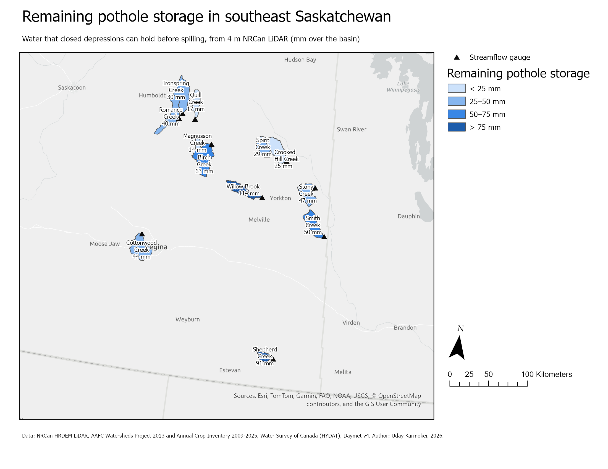
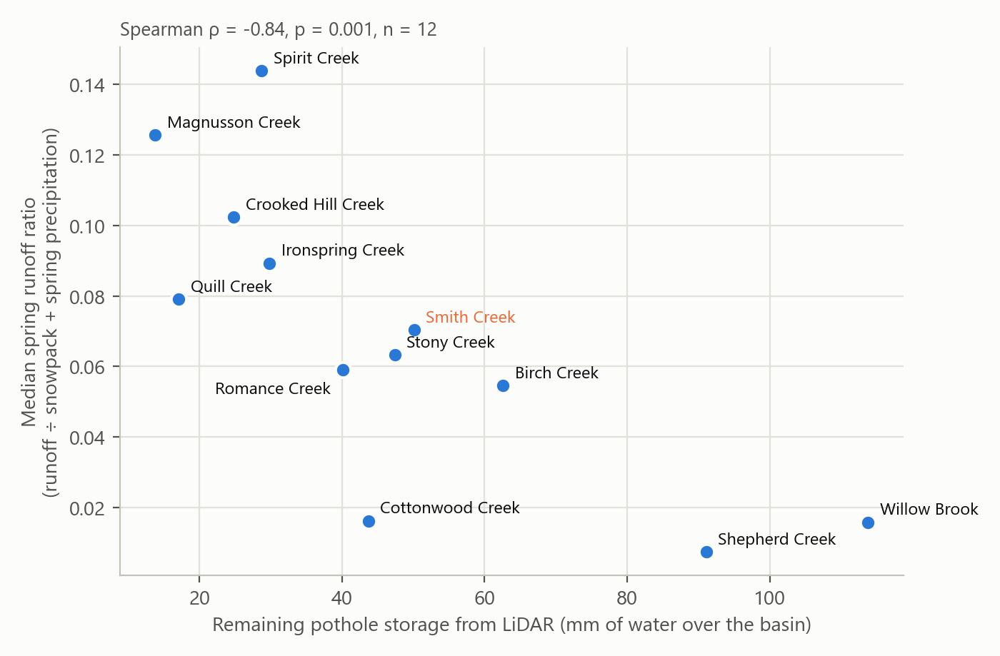
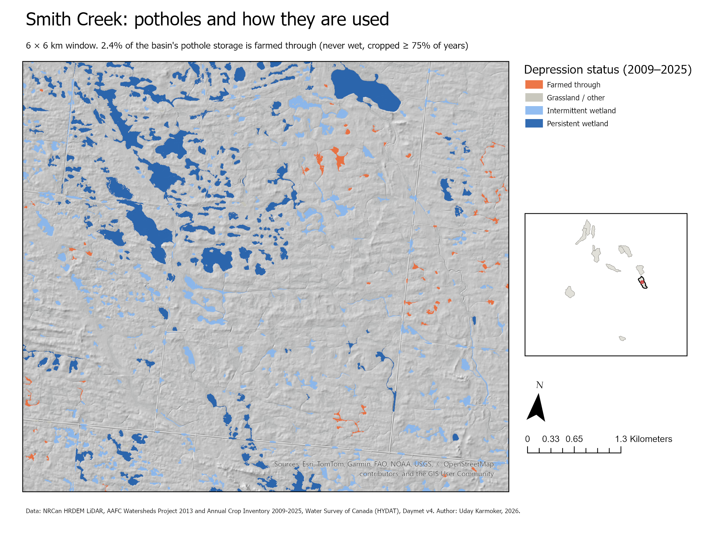
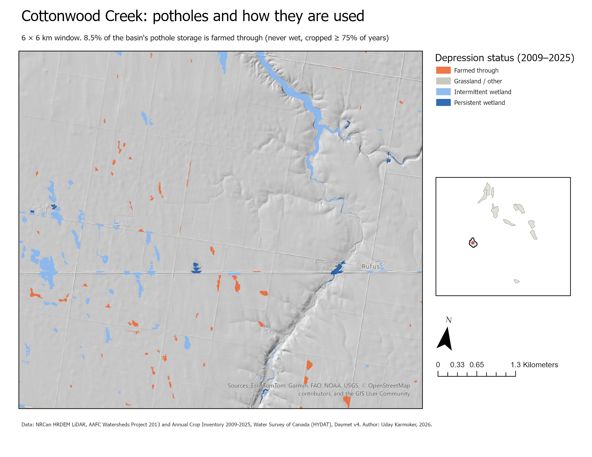
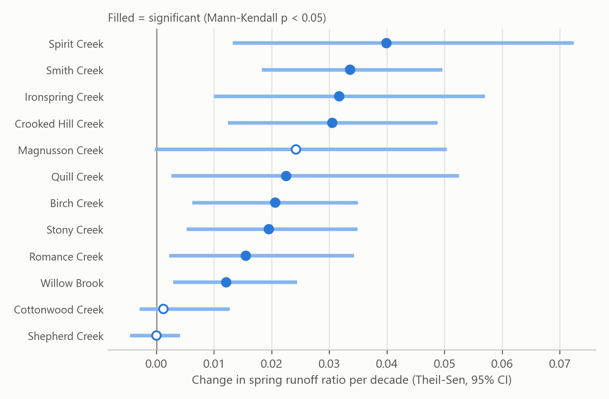
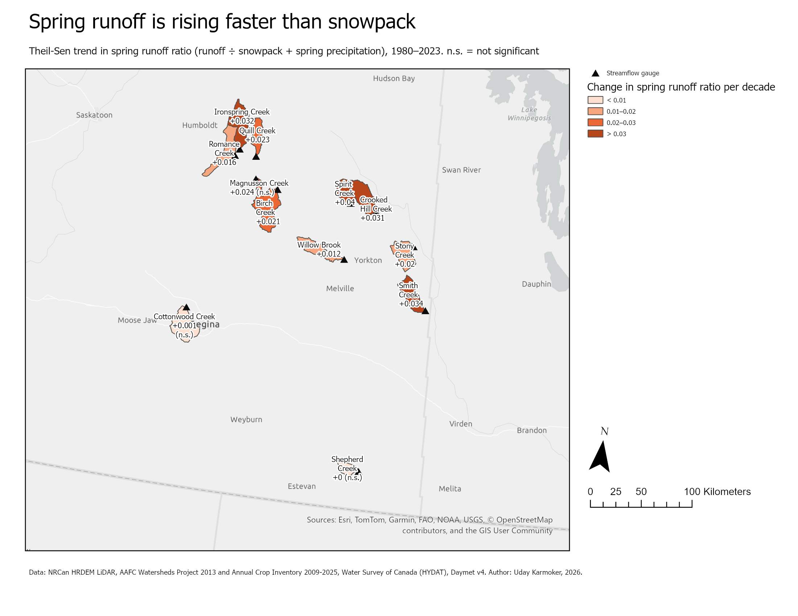

# Prairie Wetland Drainage and Spring Runoff in Southeast Saskatchewan

**How much pothole storage is left in southeast Saskatchewan's prairie basins, and do basins with less storage send more of their snowmelt downstream?**

Saskatchewan's prairie potholes are small closed depressions left by glaciers. They catch snowmelt every spring. Draining them for farming can increase flooding downstream, but most basins have never had their remaining storage measured. This project maps every pothole of 0.1 ha or more in 12 gauged basins from 4 m LiDAR. It classifies how each pothole has been used from 17 years of crop maps, and tests whether storage explains spring runoff.

Built with **ArcGIS Pro 3.4 (arcpy, Spatial Analyst, arcpy.mp)** and Python. Every step, from downloading the data to the finished map layouts, runs from one script.



## Key findings

| | |
|---|---|
| **Storage controls runoff** | Basins with less remaining pothole storage produce more spring runoff per unit of snowpack and spring rain: Spearman ρ = **−0.84**, p = 0.001, n = 12 basins. |
| **Crop-map drainage figures don't** | The share of pothole storage that is farmed through (ρ = 0.29, p = 0.35) and AAFC's "effective drainage area" (ρ = 0.24, p = 0.46) do not explain the differences. Measured LiDAR storage does. |
| **Runoff is rising** | The spring runoff ratio rose significantly (Mann-Kendall p < 0.05) in **9 of 12** basins over 1980–2023. Smith Creek has the strongest trend (+0.034 per decade on a median of 0.07). |
| **Validated** | 10.7% of Smith Creek is wetland depressions (2009–2025), against **11.0%** mapped for 2008 in the long-term Smith Creek Research Basin study (Pomeroy et al., 2014). |
| **Storage varies 8-fold** | Storage runs from 14 mm (Magnusson Creek) to 114 mm (Willow Brook) of water over the basin. |



## Study area

There are 12 Water Survey of Canada gauged basins (92–689 km²) across the pothole region of southeast Saskatchewan, centred on the **Smith Creek Research Basin**, one of the most studied prairie wetland basins in Canada. Basin boundaries are AAFC Watersheds Project 2013 gross drainage areas. Yorkton Creek was dropped because it contains Willow Brook, and nested basins would double-count.

## Method

```
NRCan HRDEM 2 m LiDAR ──► 4 m DEM ──► cut road & rail embankments ──► Fill − DEM = depth
                                                                       │
                                     Region Group + Zonal Statistics ◄─┘
                                                │
             one polygon per pothole: area, max depth, storage volume
                                                │
AAFC Annual Crop Inventory 2009–2025 ──► wet / cropped in each year ──► status class
                                                │
Water Survey of Canada daily flow ─┐            ▼
Daymet snowpack + precipitation ───┴──► spring runoff ratio ──► Spearman, Theil-Sen, Mann-Kendall
```

1. **Depressions (Spatial Analyst).** The HRDEM 2 m bare-earth mosaic is read straight from NRCan's cloud-optimised GeoTIFFs and resampled to 4 m. `Fill − DEM` gives the depth of water each cell holds before it spills. Connected cells deeper than 0.10 m are grouped into depressions with `RegionGroup`, and `ZonalStatisticsAsTable` gives each one its area, maximum depth and volume. Depressions under 0.1 ha are dropped.
2. **Embankment removal.** LiDAR can't see culverts, so every road or rail grade acts as a dam, and the valley behind it fills like a pothole. Road cells (NRN, 12 m half-width) and railway and highway cells (OpenStreetMap rail including abandoned lines, plus NRN highways, 30 m half-width) are lowered to the lowest nearby ground with `FocalStatistics`. That mimics the culvert. Without this step, one rail crossing turned the Cottonwood Creek valley into a 1,256 ha "pothole" holding 45% of the basin's storage. With it, the valley drains and Cottonwood's storage falls from 109 mm to 44 mm. Closed pits deeper than 10 m (gravel and borrow pits) are excluded.
3. **Wetland status.** Each depression is overlaid on 17 years of the AAFC Annual Crop Inventory (30 m) and classified:

   | Class | Rule |
   |---|---|
   | Persistent wetland | water or wetland in ≥ 50% of years |
   | Intermittent wetland | wet in some years |
   | Farmed through | never wet, cropped in ≥ 75% of years |
   | Grassland / other | everything else |
4. **Runoff ratio.** Mar–Jun runoff (mm over the basin) ÷ (peak Jan–Apr snow water equivalent + Apr–Jun precipitation), per basin and year. A year is kept only if its Apr–Jun flow record is at least 90% complete, giving 510 basin-years.
5. **Statistics.** Spearman rank correlation across basins; Theil-Sen slope and Mann-Kendall test within each basin.
6. **Maps.** Built with `arcpy.mp` from a blank project: graduated symbology, Arcade labels, CIM edits for legends and halos, close-ups on a LiDAR hillshade with locator insets, and PDF/PNG export.

## Results

### Pothole storage

| Basin | Area (km²) | Potholes | Depression area | Storage (mm) | Median spring runoff ratio |
|---|---:|---:|---:|---:|---:|
| Magnusson Creek | 92 | 644 | 3.0% | 13.8 | 0.126 |
| Quill Creek | 268 | 2,906 | 5.1% | 17.1 | 0.079 |
| Crooked Hill Creek | 560 | 8,756 | 7.1% | 24.8 | 0.102 |
| Spirit Creek | 255 | 3,629 | 7.1% | 28.7 | 0.144 |
| Ironspring Creek | 559 | 5,194 | 6.1% | 29.8 | 0.089 |
| Romance Creek | 526 | 6,001 | 8.2% | 40.1 | 0.059 |
| Cottonwood Creek | 619 | 4,021 | 6.8% | 43.7 | 0.016 |
| Stony Creek | 438 | 7,492 | 11.6% | 47.4 | 0.063 |
| **Smith Creek** | 439 | 7,540 | 11.4% | 50.1 | 0.070 |
| Birch Creek | 689 | 10,177 | 11.2% | 62.6 | 0.055 |
| Shepherd Creek | 174 | 3,155 | 20.1% | 91.1 | 0.007 |
| Willow Brook | 384 | 8,011 | 18.8% | 113.8 | 0.016 |

Full tables: [`outputs/`](outputs/).

### How the potholes are used

In most basins, more than 90% of storage sits in potholes that hold water in at least some years. Little of it is farmed through: 0.4% in Shepherd Creek, 10.9% in Ironspring Creek. Magnusson Creek, the most drained basin, has only 9% of its storage in persistent wetlands.

| Smith Creek | Cottonwood Creek |
|---|---|
|  |  |

### Spring runoff trends





## Interactive web map

**[Open the web map](https://karmok3r.github.io/Prairie-Wetland-Drainage-Spring-Flooding-ArcGIS-Pro/)**: click a basin for all its metrics, switch between storage and runoff trend, and zoom into Smith Creek's 7,540 potholes coloured by status ([direct link](https://karmok3r.github.io/Prairie-Wetland-Drainage-Spring-Flooding-ArcGIS-Pro/#smith)).

It runs on Leaflet and GitHub Pages and needs no server or account. `scripts/07_export_web_map.py` exports the layers to simplified GeoJSON in `docs/data/`.

## Limitations

- **12 basins show an association, not a cause.** Storage is measured once (LiDAR around 2010–2020), so the rising runoff trends can't be pinned on drainage. Warmer winters, rain-on-snow and wetter springs also raise runoff ratios, and the trends could be partly climatic.
- **Cottonwood Creek is drier than the rest.** It sits on the Regina Plain and receives the least water (median 180 mm vs about 230 mm elsewhere). Its low runoff ratio partly reflects that rather than storage alone.
- **Ditch-drained wetlands are invisible.** A pothole drained by a surface ditch still appears as a depression in the LiDAR unless the ditch cuts its rim at 4 m resolution, so storage is an upper bound.
- **Embankment removal is approximate.** It relies on mapped roads and rails, so unmapped farm crossings and field approaches can still dam small valleys.
- **The 30 m crop inventory mixes pixels.** Potholes under about 0.3 ha are classified from mixed water and crop pixels.
- **Climate is sampled at one point.** Daymet values come from each basin's centroid, not averaged over the basin.

## Reproduce

Requires ArcGIS Pro 3.x with Spatial Analyst. About 2.6 GB of data is downloaded on the first run.

```bash
"C:\Program Files\ArcGIS\Pro\bin\Python\envs\arcgispro-py3\python.exe" run_all.py
```

| Script | What it does | Time |
|---|---|---|
| `scripts/01_download_data.py` | AAFC basins, WSC flow, Daymet, crop inventory, NRN roads, OSM rails, HRDEM LiDAR | once; depends on connection |
| `scripts/02_depressions.py` | embankment removal and pothole mapping | ~55 min (resumes if interrupted; `--force` recomputes) |
| `scripts/03_wetland_status.py` | 17-year crop-inventory status per pothole | ~8 min |
| `scripts/04_runoff_analysis.py` | runoff ratios, correlations, trends, charts | < 1 min |
| `scripts/05_make_maps.py` | builds `Prairie_Wetland_Storage.aprx` and exports the four layouts | ~2 min |
| `scripts/06_publish_web_map.py` | optional: hosted feature layer + web map on ArcGIS Online, using ArcGIS Pro's sign-in (items are created private) | ~2 min |
| `scripts/07_export_web_map.py` | GeoJSON for the Leaflet web map in `docs/` | < 1 min |

`run_all.py` stops Windows from sleeping during the run. A sleeping laptop looks exactly like a hung geoprocessing tool.

### Reusable tool

[`toolbox/DepressionStorage.pyt`](toolbox/DepressionStorage.pyt) packages the depression method as an ArcGIS Pro geoprocessing tool. It works on any projected DEM, with optional road removal and depth and area thresholds.

## Data sources

All open data:
- NRCan **HRDEM** 2 m LiDAR mosaic
- AAFC **Watersheds Project 2013** and **Annual Crop Inventory** 2009–2025
- Water Survey of Canada **HYDAT** daily flow (via MSC GeoMet)
- Statistics Canada **National Road Network**
- These three are under the Open Government Licence – Canada: OGL. **OpenStreetMap** railways (ODbL). **Daymet v4** (ORNL DAAC).

**Benchmark:** Pomeroy et al. (2014), Smith Creek Research Basin wetland drainage study, Centre for Hydrology, University of Saskatchewan. It maps 11% wetland area in 2008, down from 24% in 1958.

## Skills demonstrated

- **Terrain analysis with arcpy Spatial Analyst:** Fill, RegionGroup, ZonalStatisticsAsTable, FocalStatistics, ExtractByAttributes.
- **Raster and vector integration:** reading cloud-optimised GeoTIFFs over HTTP with GDAL, reprojecting between CRSs, rasterising roads and rails.
- **Automated cartography with arcpy.mp:** a project built from a blank `.aprx`, CIM edits, Arcade labels, insets and exports.
- **Hydrological time series and non-parametric statistics:** Spearman, Theil-Sen and Mann-Kendall with pandas and scipy.
- **Quality control:** checked against a published benchmark, and false depressions traced to specific embankments and removed.
- **Python toolbox (.pyt) development** and a reproducible, resumable pipeline.
- **Web mapping:** GeoJSON export with simplification, and a Leaflet map with popups, a view toggle and lazy-loaded detail, hosted free on GitHub Pages.

## About this project

The analysis was designed and built by Uday Karmoker with Claude (Anthropic) as an AI pair programmer, which wrote and debugged the code under direction. The research framing, data choices and checks of every result against the maps and the published Smith Creek benchmark were reviewed by the author.
